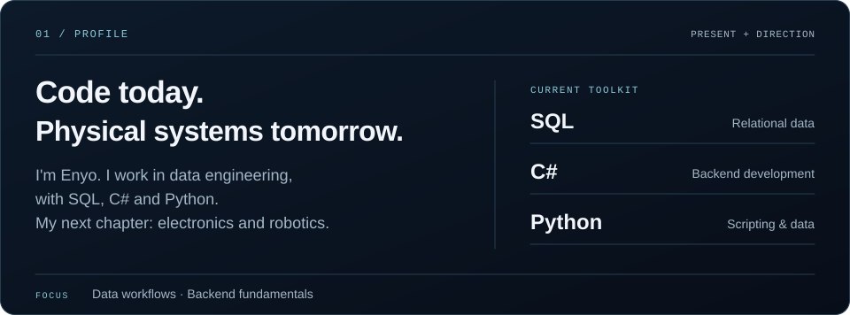
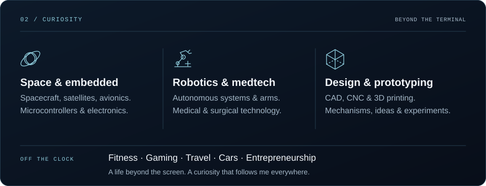
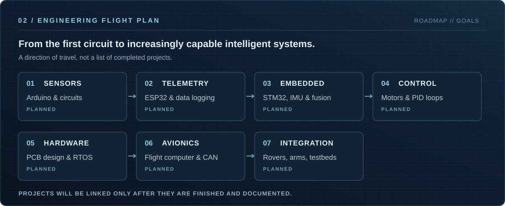
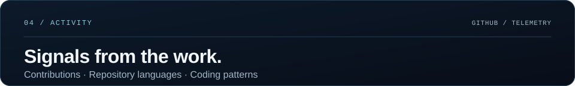
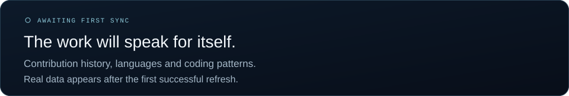
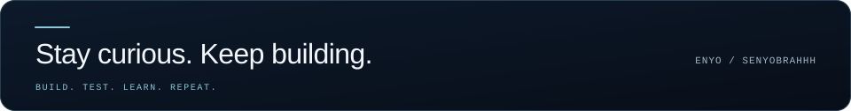

<picture>
  <source media="(prefers-reduced-motion: reduce) and (max-width: 600px)" srcset="./assets/mobile/banner-static.svg" />
  <source media="(prefers-reduced-motion: reduce)" srcset="./assets/banner-static.svg" />
  <source media="(max-width: 600px)" srcset="./assets/mobile/banner.svg" />
  
</picture>

  <picture>
    <source media="(prefers-reduced-motion: reduce) and (max-width: 600px)" srcset="./assets/mobile/typing-static.svg" />
    <source media="(prefers-reduced-motion: reduce)" srcset="./assets/typing-static.svg" />
    <source media="(max-width: 600px)" srcset="./assets/mobile/typing.svg" />
    
  </picture>
  
  &nbsp;
  

<picture>
  <source media="(max-width: 600px)" srcset="./assets/mobile/dashboard-overview.svg" />
  
</picture>

<picture>
  <source media="(max-width: 600px)" srcset="./assets/mobile/dashboard-interests.svg" />
  
</picture>

<picture>
  <source media="(max-width: 600px)" srcset="./assets/mobile/dashboard-roadmap.svg" />
  
</picture>

<!-- Add a project showcase only when completed, documented builds are ready. -->

<picture>
  <source media="(max-width: 600px)" srcset="./assets/mobile/telemetry-heading.svg" />
  
</picture>

<picture>
  <source media="(max-width: 600px)" srcset="./assets/metrics/github-mobile.svg" />
  
</picture>

Generated from GitHub activity with <a href="https://github.com/lowlighter/metrics">Lowlighter Metrics</a>. Repository language usage is separate from my current toolkit.

  
Contribution snake

   
  <picture>
    <source media="(prefers-reduced-motion: reduce)" srcset="https://raw.githubusercontent.com/Senyobrahhh/Senyobrahhh/output/github-snake-orbital-static.svg" />
    
  </picture>

 

<picture>
  <source media="(max-width: 600px)" srcset="./assets/mobile/footer.svg" />
  
</picture>

About Enyo · text version

I'm **Enyo (Senyobrahhh)**, a developer currently working in **data engineering**. My current programming toolkit is **SQL, C# and Python**. I'm strengthening my knowledge of relational data, SQL Server, T-SQL, backend applications, software architecture and testing.

I'm interested in how software interacts with physical systems: **spacecraft and satellites, embedded electronics, autonomous robotics, robotic arms, medical and surgical technology, mechanical design and prototyping**. CAD, CNC and 3D printing are areas I want to explore as part of that path. I'm beginning the hardware side of this journey; these interests are not claims of professional experience.

Away from code, I enjoy **fitness and bodybuilding, gaming and hardware, travel and aviation, cars and automotive technology**, and exploring ideas for future businesses.

**Planned learning progression**

1. Arduino sensors and electronics fundamentals.
2. ESP32 telemetry and data logging.
3. STM32 microcontrollers, IMUs and sensor fusion.
4. Motor control, feedback loops and PID.
5. Autonomous robotics and robotic arms.
6. Custom PCB design and RTOS architecture.
7. Modular flight computers and CAN bus.
8. Spacecraft simulators and integrated engineering testbeds.

All stages above are **planned**. Completed projects will be featured when they are ready and documented.

