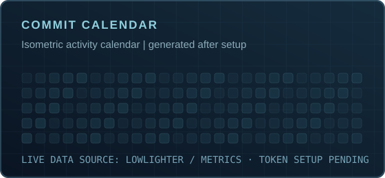
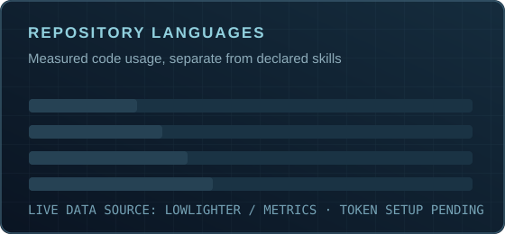
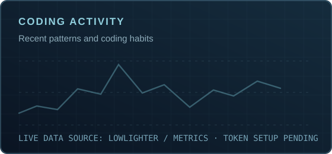

**Developer · Curious builder · Exploring what comes next**

<!-- PERSONAL DASHBOARD: these illustrations use the same dark orbital design language as the banner. -->

### `> executive_summary`

I'm **Enyo (Senyobrahhh)** — a developer working in **data engineering**, fascinated by how software interacts with physical systems. My current toolkit is **SQL, C# and Python**. I enjoy designing reliable data workflows, learning backend engineering and building the foundation for future hands-on work in robotics and electronics.

My interests go beyond code: **space exploration, medical robotics, embedded systems, fitness, gaming and travel**. I'm at the beginning of the hardware side of that journey, and I'd rather show real progress than claim projects I haven't finished.

<b>Open CV-style focus areas</b>

- **Current work:** Data engineering; relational data, SQL Server and T-SQL.
- **Software direction:** C#, backend applications, architecture, databases and testing.
- **Hardware direction:** Electronics, microcontrollers, telemetry, control systems and robotic mechanisms.
- **Long-term interests:** Spacecraft avionics, autonomous systems and medical robotics.
- **Outside tech:** Fitness, competitive gaming, travel and creative engineering experiments.

### `> trajectory`

| Today | Next milestone | Long-term direction |
| :--- | :--- | :--- |
| Strengthen SQL, C# and Python; data and backend engineering | Document complete electronics and software builds | Advanced robotics, medical technology and spacecraft systems |

*Only completed and documented projects will be showcased here. This is a learning roadmap, not a claims-of-experience chart.*

---

### `> github --telemetry`

### `> activity --animate`

<picture>
  <source media="(prefers-color-scheme: dark)" srcset="https://raw.githubusercontent.com/Senyobrahhh/Senyobrahhh/output/github-snake-dark.svg" />
  <source media="(prefers-color-scheme: light)" srcset="https://raw.githubusercontent.com/Senyobrahhh/Senyobrahhh/output/github-snake.svg" />
  
</picture>

---

**STAY CURIOUS. BUILD THINGS. KEEP MOVING.**

Build. Test. Learn. Repeat.

