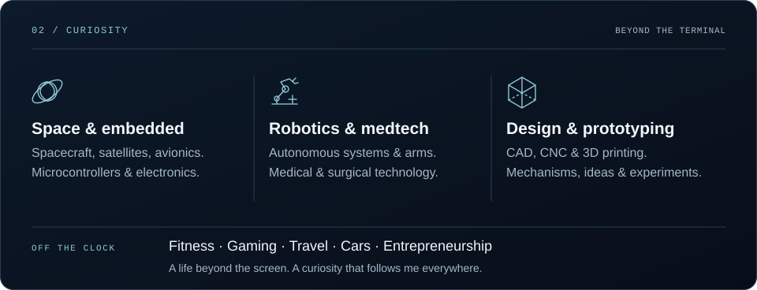
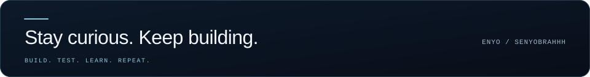

<!-- ==================== HEADER ==================== -->

  <picture>
    <source media="(prefers-reduced-motion: reduce) and (max-width: 600px)" srcset="./assets/mobile/banner-static.svg" />
    <source media="(prefers-reduced-motion: reduce)" srcset="./assets/banner-static.svg" />
    <source media="(max-width: 600px)" srcset="./assets/mobile/banner.svg" />
    
  </picture>

<!-- ==================== TYPING ANIMATION ==================== -->

  <picture>
    <source media="(prefers-reduced-motion: reduce) and (max-width: 600px)" srcset="./assets/mobile/typing-static.svg" />
    <source media="(prefers-reduced-motion: reduce)" srcset="./assets/typing-static.svg" />
    <source media="(max-width: 600px)" srcset="./assets/mobile/typing.svg" />
    
  </picture>

  
  &nbsp;
  

<!-- ==================== PROFILE ==================== -->

<h2 align="center">
  Small steps. 
  Extraordinary possibilities.
</h2>

  I'm <strong>Enyo</strong>, a developer working in
  <strong>data engineering</strong>, passionate about
  software, technology and building things.

  <strong>LANGUAGES & TECHNOLOGIES</strong>

  
  
  
  
  

  Backend Development · Data Engineering · Web Development

 

<!-- ==================== ENGINEERING INTERESTS ==================== -->

  <picture>
    <source media="(max-width: 600px)" srcset="./assets/mobile/dashboard-interests.svg" />
    
  </picture>

<!-- ==================== ABOUT ENYO ==================== -->

<h2 align="center">👨‍💻 About Enyo</h2>

  <strong>Developer by profession. Explorer by curiosity.</strong>

Hey! I'm **Enyo (Senyobrahhh)** 👋

I'm a developer currently working in **data engineering**, where I spend my time learning, solving problems and improving my skills in databases, backend development and software architecture.

My main programming languages are **C#, SQL and Python**, alongside **HTML and CSS** for web development.

What makes engineering exciting to me is that there's always something new to discover. I enjoy understanding not just **how things work**, but **why they work** — and figuring out how to build them myself.

### 🚀 What I'm passionate about

My interests extend far beyond traditional software development.

I'm fascinated by **space exploration, spacecraft, satellites, embedded electronics, robotics and autonomous systems**.

I'm also interested in **medical and surgical technology, mechanical engineering, CAD, CNC machining and 3D printing**.

These are fields I'm exploring and gradually learning more about, with the goal of turning curiosity into practical knowledge and real projects.

### ⚡ Beyond the keyboard

Engineering is a big part of my life, but definitely not the only one.

- 🏋️ **Fitness & bodybuilding** — Discipline, consistency and pushing my limits.
- 🎮 **Gaming & technology** — Video games, hardware and everything in between.
- ✈️ **Travel & aviation** — New places, different cultures and exploring the world.
- 💡 **Entrepreneurship** — Creative ideas, building products and exploring opportunities.

### 🎯 My philosophy

I don't believe you need to know everything before you start building something.

Learn the fundamentals. Experiment. Make mistakes. Figure out what went wrong. Improve.

Every project teaches something new, and every small improvement moves you forward.

  <strong>Stay curious. Keep building. Never stop learning.</strong>

 

<!-- ==================== CONTRIBUTION SNAKE ==================== -->
<!-- ORIGINAL SNAKE - UNCHANGED -->

  <picture>
    <source media="(prefers-reduced-motion: reduce)" srcset="https://raw.githubusercontent.com/Senyobrahhh/Senyobrahhh/output/github-snake-orbital-static.svg" />
    
  </picture>

 

<!-- ==================== FOOTER ==================== -->

  <picture>
    <source media="(max-width: 600px)" srcset="./assets/mobile/footer.svg" />
    
  </picture>

